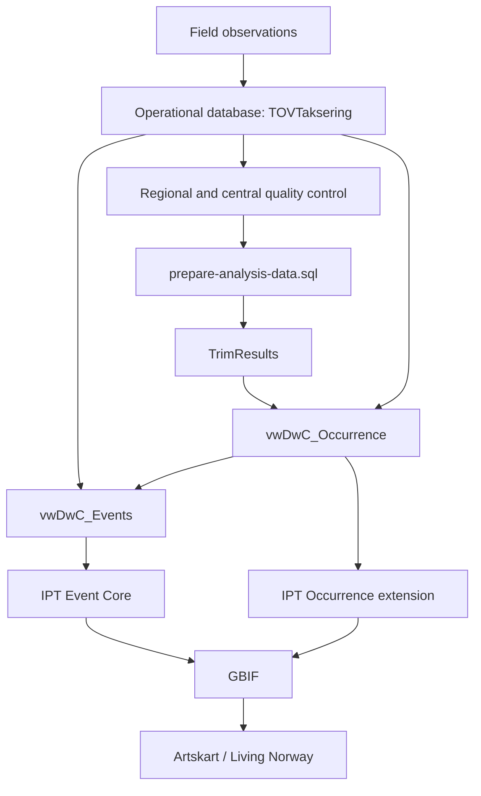

# D2 – Public sampling-event dataset

Technical documentation for the Norwegian Bird Monitoring programme.

**Documentation basis:** IPT source queries and SQL view definitions supplied on 25 November 2026, compared with `meta.xml`, EML and the complete published Event and Occurrence files in IPT version 1.15. All source output columns have corresponding published terms. The source-to-term assignments in the IPT administration interface and the exact deployed code revision were not independently inspected. This is not a complete standalone database deployment or reproduction specification.

## 1. Scope and authoritative sources

D2 is the public occurrence data product defined in the project data management plan (16 October 2026). NINA publishes it as a Darwin Core Event Core with an Occurrence extension using the GBIF Integrated Publishing Toolkit (IPT).

- Resource: `tove_birdsampling`
- [NINA IPT – authoritative scientific metadata and version history](https://ipt.nina.no/resource?r=tove_birdsampling)
- [GBIF dataset](https://www.gbif.org/dataset/4a00502d-6342-4294-aad1-9727e5c24041)
- DOI: [10.15468/6jmw2e](https://doi.org/10.15468/6jmw2e)
- Dataset licence: CC BY 4.0
- Technical baseline: source definitions supplied on 2026-11-25, associated with the 2026 delivery (IPT version 1.15). The exact deployed revision at publication must be recorded in the annual delivery archive.

IPT remains the source of record for scientific metadata (EML), the published archive and dataset versions. This document describes the production workflow and public data transformation. Release-specific information is retained in the annual delivery documentation.

## 2. Data flow and annual preparation



The annual preparation script, [`sql/prepare-analysis-data.sql`](../sql/prepare-analysis-data.sql), prepares the analysis and export tables `TrimSites` and `TrimResults` after quality control. The script defines eligible route-years and prepares route-year-species counts, including point counts, relevant line counts and species-specific flock conversion. Flocks contribute the rounded-up flock size divided by five or two, or zero, according to the species-specific flock code. The analysis script contains additional inclusion rules and internal missing-data conventions; refer to the revision actually used for the annual delivery.

`TrimResults` directly supplies the occurrence quantities and record identifiers. `TrimSites` is part of the analysis preparation, but neither public source view queries it directly. Events are sourced from route information rather than directly from the analysis tables. The occurrence view also restricts the event view to events with at least one exportable occurrence.

**Operational warning:** the annual preparation script rebuilds production analysis tables. Follow the backup and execution instructions; do not execute it merely to test the public export.

## 3. IPT source queries and data model

Database: Microsoft SQL Server, `TOVTaksering`.

| IPT table | SQL query | View definition |
|---|---|---|
| Event Core | `SELECT * FROM vwDwC_Events` | [`sql/ipt/vwDwC_Events.sql`](../sql/ipt/vwDwC_Events.sql) |
| Occurrence extension | `SELECT * FROM vwDwC_Occurrence` | [`sql/ipt/vwDwC_Occurrence.sql`](../sql/ipt/vwDwC_Occurrence.sql) |

A sampling event represents an annual route survey. The expected event key is `eventID` from `dbo.Ruteinformasjon`. The occurrence view obtains the same `eventID` by joining `TrimResults.Site` and `TrimResults.Year` to `Ruteinformasjon.FK_RuteID` and `Ruteinformasjon.Aar`. The logical relationship is one event to many occurrences. In the verified archive (IPT 1.15), the generated `id` column in both files equals the respective `eventID` on every row. The Event `id` is unique, and every Occurrence has a corresponding Event; every published Event also has at least one Occurrence.

`catalogNumber` is `TrimResults.TrimId`. The occurrence identifier is constructed as `urn:catalog:NINA:TOV-E:` followed by `TrimId`. The expected occurrence grain is route, year and species. Verify identifier uniqueness and stability across rebuilds and republications; the view definitions alone do not establish how IDs are assigned or retained upstream.

## 4. Event Core source view

`dbo.vwDwC_Events` joins `Ruteinformasjon`, `ASkjemaInfo`, `RuteVerifisertStatus` and municipality metadata (`Metadata.dbo.Kommune`). A route-year is included only if:

- `PunktGodkjent`, `DatoKlGodkjent` and `LinjeGodkjent` are all 1 (NULL treated as 0);
- `IkkeTaksert` is not 1 (NULL treated as 0);
- its `eventID` exists in `vwDwC_Occurrence`.

Consequently, the public event source excludes approved surveys that have no exportable occurrences. The event view has no separate explicit first-survey-year or calendar-year filter. Upstream rules in the preparation of `TrimResults` affect which events can be included.

### Event source columns

The following SQL output aliases have corresponding published terms in the verified archive (IPT 1.15). See section 7 for the namespace and identifier details. The view definition is the detailed reference for the source expressions.

| Output column(s) | Source / meaning |
|---|---|
| `eventID` | `Ruteinformasjon.eventID` |
| `dcterms:type` | Constant `Event` |
| `ownerInstitutionCode` | Constant `NINA/BIRDLIFE` |
| `eventDate`; `year`, `month`, `day` | Survey date constructed from `Ruteinformasjon.Aar`, `Maaned`, `Dag`; date components also provided separately |
| `eventTime` | Start and stop times from `Ruteinformasjon.StartKl` and `StoppKl`, joined by `/` |
| `samplingProtocol` | URL of the English methodology PDF |
| `sampleSizeValue`, `sampleSizeUnit` | `ASkjemaInfo.LengdeRute` rounded to whole metres; constant `metre` |
| `samplingEffort` | Duration calculated in minutes from start/stop times and `ASkjemaInfo.nPkt` from the route register |
| `locationID` | `Ruteinformasjon.FK_RuteID` (route identifier) |
| `countryCode`, `country` | Constants `NO`, `Norway` |
| `datasetName` | Constant `Norwegian bird monitoring` |
| `stateProvince`, `municipality` | `Komm.Region`, `Komm.Kommune` from municipality lookup |
| `locality` | `ASkjemaInfo.NavnRute` |
| `decimalLatitude`, `decimalLongitude` | `ASkjemaInfo.RandomLat`, `RandomLong`, rounded to five decimal places |
| `geodeticDatum` | Constant `EPSG:4326` |
| `coordinateUncertaintyInMeters` | Constant 5000 |
| `minimumElevationInMeters`, `maximumElevationInMeters` | `ASkjemaInfo.Lavest`, `Hoyest` |
| `dataGeneralizations`, `informationWithheld`, `locationRemarks` | Constants describing displaced coordinates and withheld information |
| `dcterms:modified` | `Ruteinformasjon.DatoEndret`, ISO-style SQL conversion (style 126) |

The sampling-point count is sourced from route-level information, not an event-specific count of points actually visited. Interpret it accordingly unless independently verified. Use consistently zero-padded ISO-style time intervals (`HH:mm/HH:mm` or a suitable full ISO 8601 representation). Validate survey dates and durations before release; negative durations must be investigated and corrected in the source or handled explicitly, not converted to positive values without evidence.

## 5. Occurrence extension source view

`dbo.vwDwC_Occurrence` uses `TrimResults`, joined to the species register (`Art`), route register (`ASkjemaInfo`), municipality metadata and route survey information (`Ruteinformasjon`). Only records meeting all of the following conditions are exported by the view:

- `TrimResults.Count > 0`;
- `ISNULL(Art.SkjulDatadeling, 0) <> 1` (species flagged with 1 are excluded; NULL is treated as 0);
- `Art.ArtsID < 9998`.

All returned rows have `occurrenceStatus = PRESENT`. Zero counts, negative internal codes and NULL counts are not exported. A missing occurrence is therefore not evidence of absence. The public quantity represents pair equivalents according to the monitoring methodology, not a count of confirmed breeding pairs or individuals.

### Occurrence source columns

| Output column(s) | Source / meaning |
|---|---|
| `dcterms:type` | Constant `Occurrence` |
| `eventID` | `Ruteinformasjon.eventID` (parent event) |
| `catalogNumber` | `TrimResults.TrimId` |
| `occurrenceID` | `urn:catalog:NINA:TOV-E:` + `TrimResults.TrimId` |
| `collectionCode` | Constant `Norwegian bird monitoring` |
| `basisOfRecord` | Constant `HumanObservation` |
| `organismQuantity` | `TrimResults.Count` (positive pair-equivalent count) |
| `organismQuantityType` | Constant `pairs` |
| `occurrenceRemarks` | Description of aggregated point and line sampling, using the route register's `nPkt` |
| `scientificName` | `Art.Artsnavn_Lat` |
| `Kingdom`, `Phylum`, `Class`, `Order`, `Family`, `Genus` | Corresponding species-register fields (published with lowercase Darwin Core term names) |
| `specificEpithet` | `Art.Species` |
| `vernacularName` | `Art.Artsnavn_Norsk` |
| `dcterms:modified` | `TrimResults.DatoEndret`, ISO-style SQL conversion (style 126) |
| `occurrenceStatus` | Constant `PRESENT` |

The occurrence view does not repeat all event approval and non-survey filters. These conditions are applied in the event view and the annual analysis/export preparation. Check that every occurrence eventID is present in the Event source; the event view's `IN` condition alone guarantees only the opposite inclusion direction.

## 6. Spatial generalisation and disclosure controls

The Event view uses precomputed generalised route coordinates (`ASkjemaInfo.RandomLat` and `RandomLong`), not the original route centre or counting-point coordinates. The published explanatory text describes displacement of 1,000–5,000 metres from the original route centre. The declared datum is EPSG:4326, with a coordinate uncertainty of 5,000 metres. The exact computation and persistence of these coordinates are outside these view definitions. The five-decimal rounding does not represent the true positional accuracy.

The occurrence source excludes species flagged for non-disclosure. Observer names and exact counting-point coordinates are not selected by either view. Verify the public release does not expose protected sites through the combination of route identifiers, locality names, elevation ranges or other attributes, including linkage to other datasets. The 5,000 m uncertainty value describes the declared route-centre displacement bound; it is not independently verified here as covering all possible observation positions. Review the occurrence remarks and uncertainty against the intended spatial representation.

Do not publish true/generalised coordinate lookup tables, exact locations, personal data, credentials, reversible displacement parameters or other information that undermines site protection. Retain the full generalisation implementation internally if publishing it would undermine protection. Confirm the two SQL view definitions are suitable for public release before committing them.

## 7. IPT mapping and archive structure

The published Darwin Core Archive for IPT version 1.15 was inspected directly. Its `meta.xml` declares:

| Property | Event Core | Occurrence extension |
|---|---|---|
| File | `event.txt` | `occurrence.txt` |
| Row type | `http://rs.tdwg.org/dwc/terms/Event` | `http://rs.tdwg.org/dwc/terms/Occurrence` |
| Link at column index 0 (zero-based) | `<id index="0"/>` | `<coreid index="0"/>` |
| Header at index 0 | `id` | `id` (parent Event ID, not the occurrence identifier) |
| Darwin Core `eventID` column index | 7 | 11 |
| Published term columns (excluding generated link column) | 29 | 20 |
| Physical columns (including `id`) | 30 | 21 |

Both files are UTF-8, tab-separated, newline-delimited text without a text enclosure character, with one header line. The archive also contains `eml.xml` (EML 2.2.0, GBIF profile 1.3) and `meta.xml`.

All 29 Event and 20 Occurrence source aliases correspond to published terms in the archive; no source field is evidently omitted or additional term introduced. The generated link column is additional to those terms. In particular:

- SQL `dcterms:type` is exported using `http://purl.org/dc/elements/1.1/type` (the actual descriptor URI); SQL `dcterms:modified` uses `http://purl.org/dc/terms/modified`.
- The taxonomic aliases `Kingdom`, `Phylum`, `Class`, `Order`, `Family`, `Genus` correspond to their lowercase Darwin Core terms.
- The Event `id` and `eventID` are identical in every published Event row, and the Occurrence `id` and `eventID` are identical in every published extension row. `occurrenceID` is a separate unique identifier, not the extension link.
- All other term names match the source aliases listed in sections 4 and 5. The descriptor gives exact term URIs and positions; the view definitions give SQL source expressions.

The checked archive and the supplied source definitions are consistent at the field-name and link level. `meta.xml` does not encode the original database column assignments or all possible IPT defaults and transformations; the IPT administration mapping itself has not been independently inspected. Confirm the assignments there if they change or if a source-to-output discrepancy is found.

**Documentation approach:** retain the version-specific archive internally, including its original `meta.xml`. Together with this document and the version-controlled SQL views, it provides a compact mapping reference; a separately maintained `d2-ipt-mapping.tsv` is unnecessary for the observed field layout. Document any future non-direct assignments, omissions or additional constants explicitly.

## 8. Annual publication and validation

1. Complete regional and central quality control and confirm the release year.
2. Run or confirm the approved annual analysis/export preparation. Record its actual execution date and Git revision, together with the source view revisions used.
3. Review source view and IPT mapping changes. Validate event and occurrence identifiers, parent-child links, quantities and dates; check the effect of approval and species filters, taxonomic assignments and disclosure controls.
4. Update IPT metadata, including actual temporal coverage and relevant methodological changes. Publish a new public IPT version and record version, date and event/occurrence totals.
5. Download the version-specific Darwin Core Archive. Check `meta.xml`, EML and actual records against the published summary; verify field layout, key uniqueness and referential integrity, positive integer quantities, date consistency, time intervals and survey duration. Inspect missing values, in particular taxonomic fields for records identified above species level. Retain the original archive and a dated validation record in the controlled annual delivery folder.
6. Confirm that GBIF has harvested and indexed the new version and that downstream data in Artskart and Living Norway have been updated. IPT publication alone does not demonstrate downstream ingestion.
7. Record the release in the annual delivery note, including any unresolved checks and the actual code revision. Preserve previous versions if the delivery is corrected.

## 9. Repository contents and versioning

```text
norwegian-bird-monitoring/
  README.md
  sql/
    prepare-analysis-data.sql
    ipt/
      vwDwC_Occurrence.sql
      vwDwC_Events.sql
  docs/
    d2-publication.md
```

The SQL files are reference definitions of existing production views, not a complete standalone deployment. The Event view depends on the Occurrence view. Both require operational tables and municipality metadata. Their inclusion is subject to review for public disclosure. Version-control the transformation logic and documentation; preserve the exact annual archive and code references in the project delivery folder. The public dataset is licensed separately under CC BY 4.0; repository code is subject to the repository licence. Do not commit D1 data or confidential source data.

## References

- Vang et al. (2023). *Norsk hekkefuglovervåking systemdokumentasjon*. NINA Report 2230. <https://hdl.handle.net/11250/3047289>.
- Project data management plan, 16 October 2026 (controlled project documentation).
- [NINA IPT resource](https://ipt.nina.no/resource?r=tove_birdsampling).
- [Darwin Core terms](https://dwc.tdwg.org/terms/).
