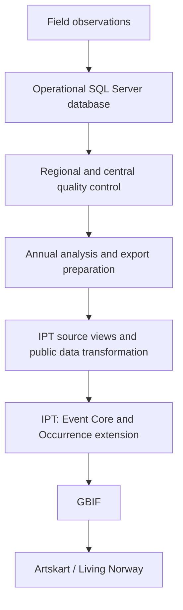

# D2 – Public sampling-event dataset

Technical documentation for the Norwegian Bird Monitoring programme.

**Status:** Initial technical documentation. The published resource and the public analysis preparation script have been reviewed. The deployed IPT source views, exact column mappings, archive schema and release-specific code revision must still be verified before this document can be considered a complete reproduction specification.

## 1. Scope and authoritative sources

D2 is the public occurrence data product defined in the project data management plan (16 October 2026). NINA publishes it as a Darwin Core Event Core with an Occurrence extension using the GBIF Integrated Publishing Toolkit (IPT).

- Resource: `tove_birdsampling`
- [IPT resource and authoritative metadata](https://ipt.nina.no/resource?r=tove_birdsampling)
- [GBIF dataset](https://www.gbif.org/dataset/4a00502d-6342-4294-aad1-9727e5c24041)
- DOI: [10.15468/6jmw2e](https://doi.org/10.15468/6jmw2e)
- Dataset licence: CC BY 4.0
- Baseline reviewed: [IPT version 1.15, 2026-11-25](https://ipt.nina.no/resource?r=tove_birdsampling&v=1.15)

IPT remains the source of record for scientific metadata (EML), published data, and dataset version history. This document describes the production workflow, source-to-target mapping and operational checks. It does not replace the EML metadata or the release-specific delivery note.

## 2. Data flow



The diagram is a logical representation. The actual SQL dependencies between the annual export tables and IPT views must be verified against the production IPT resource. Do not assume that IPT reads every output of the analysis workflow directly.

### Annual preparation script

The repository already includes [`sql/prepare-analysis-data.sql`](../sql/prepare-analysis-data.sql). Its documented purposes include preparing analysis and export data for GBIF/Artskart. In the inspected version, the script rebuilds `TrimSites` and `TrimResults` after annual quality control and applies monitoring-specific inclusion rules.

The script prepares route-year combinations, excludes the first surveyed year and unapproved or unsurveyed route-years, excludes routes with only one eligible year, and prepares route-year-species counts. It combines point-count observations and the relevant line-transect observations (`Art.Linjetaksart = 1`). The script distinguishes missing/excluded data (`-1`) from eligible route-years with no recorded observation of a species (`0`). These are internal analysis codes, not necessarily values published in D2.

The script applies species-specific flock conversions using `Art.FK_Kode_Flokk`: divide the flock size by five or two and round up, or contribute zero. Published quantities represent pair equivalents, not exact numbers of confirmed breeding pairs. The exact aggregation stage and treatment of missing/zero counts in the public export must be checked in the IPT source views.

**Operational warning:** this script rebuilds production analysis tables. Follow its backup and execution instructions. Do not execute it simply to test the public export. Record the revision actually used for each annual delivery.

## 3. Public data model and identifiers

The published resource describes a sampling event as the annual survey of a monitoring route. Associated occurrence records represent species-level counts for that route and year. The event-to-occurrence relationship is one-to-many. The published coordinates refer to displaced route centres, rather than exact survey points.

The archive descriptor (`meta.xml`) is the authoritative description of the exported columns, Darwin Core term URIs, core identifier, extension link and file delimiters. Inspect this descriptor and the IPT mapping before asserting exact terms, field names or identifier construction.

Maintain stable event and occurrence identifiers between publications. The annual preparation script generates `TrimId`; its precise use in the public mapping must be verified. Do not change identifier generation or taxonomic keys without assessing effects on GBIF and downstream consumers.

## 4. Source-to-Darwin Core mapping

The following table is a verification worksheet, **not a confirmed mapping**. The semantic content is documented by the public resource; the actual exported terms and SQL columns must be copied from the current IPT mapping and source view definitions. Delete candidate terms that are not mapped and add all other mapped terms, including constants/defaults. Store an exact snapshot of the archive descriptor with the verified mapping if useful.

| Table | Darwin Core term or concept to verify | Expected meaning / source to inspect | Verification needed |
|---|---|---|---|
| Event | Core identifier, `eventID` | Stable annual route-survey ID | Exact source column, construction and uniqueness; distinguish archive core ID from `eventID` |
| Event | `eventDate` | Survey date or date interval | Source column and ISO date representation |
| Event | `locationID` (if present) | Route identifier suitable for public use | Stability and absence of sensitive location identifiers |
| Event | `samplingProtocol`, `samplingEffort` or other effort terms (if present) | Monitoring protocol and effort | Actual mapped terms, defaults and per-event effort |
| Event | `decimalLatitude`, `decimalLongitude` | Generalised route coordinates | Actual public coordinate fields, datum and no exact locations |
| Event | `geodeticDatum`, `coordinateUncertaintyInMeters` (if present) | Coordinate reference and uncertainty after generalisation | Verify values and that uncertainty is consistent with displacement |
| Event/Occurrence | `dataGeneralizations`, `informationWithheld` (if present) | Explanation of location/record restrictions | Actual mapped level and values |
| Occurrence | Extension core link / `eventID` if present | Parent annual route-survey event | Actual archive `coreid` and foreign-key validity |
| Occurrence | `occurrenceID`, `catalogNumber` (if present) | Stable public record identifier(s) | Verify use of `TrimId` or other source and ID construction |
| Occurrence | `scientificName`, taxonomy and taxon IDs (if present) | Species identification from the project species register | Actual taxonomy fields, identifiers and handling of unmatched names |
| Occurrence | `organismQuantity`, `organismQuantityType`, `individualCount` or other count fields | Public quantities expressed in pair equivalents | Actual term(s), units and values; do not describe pair equivalents as individuals |
| Occurrence | `occurrenceStatus` (if present) | Presence/absence status | Verify whether zero counts/absences are exported and how they are represented |
| Event/Occurrence | `basisOfRecord`, licence and institutional fields (if present) | Record origin and attribution | Actual mapped fields, constants and defaults |

### Complete the verified mapping

For each IPT source, record the database object (schema and view name), source column or expression, target Darwin Core term (URI), any IPT constant/default and important transformation or filter. Use the following column structure if recording the full mapping in a separate file such as `docs/d2-ipt-mapping.tsv`:

```text
archive_table  source_view  source_column_or_expression  dwc_term_uri  ipt_constant_or_default  transformation_or_filter
```

Include unmapped source columns only if their exclusion is important to understanding the transformation or protecting sensitive information. If one source serves both data products, document the differences in inclusion criteria rather than assuming D1 and D2 are equivalent.

## 5. Database views and disclosure controls

Record the actual public source view names from IPT's **Manage Resources → source configuration** and retain a reviewed copy of their definitions under `sql/ipt/`, if approved for public release. The current view names and definitions are not verified in this document.

The DMP requires disclosure controls before publication. Public source views should ensure that observer identities and exact survey locations are excluded. The public metadata state that coordinates are displaced route centres. Verify where the displacement, sensitive-species restrictions and any record suppression are implemented. Verify that direct or indirect identifiers, comments and other fields do not reveal withheld information.

Document the protection approach at an appropriate level. Do not publish exact coordinates, lookup tables between true and generalised locations, secret seeds, reversible displacement parameters, credentials, connection strings or any information that would undermine screening. If a view includes such details, retain the full definition internally and publish only a safe description or reviewed version. Record the internal revision reference in the controlled project archive.

## 6. Annual publication procedure

1. Complete regional and central quality control and confirm the release year.
2. Run or confirm the approved annual analysis/export preparation; record script revision and execution date.
3. Review the IPT source views and column mapping for changes; update this document and any safe, version-controlled SQL definitions or mapping file if needed.
4. Validate event IDs, occurrence IDs (where mapped), extension links, date coverage, published quantities, taxonomy and disclosure controls before publication. Check the source filters and treatment of null, zero and missing records.
5. Update IPT metadata, including actual temporal coverage and any methodological changes. Publish a new public IPT version and record version, date and event/occurrence totals.
6. Download the exact version of the Darwin Core Archive; check `meta.xml`, EML metadata and actual data records against the published summary. Retain a version-specific snapshot and optionally its SHA-256 checksum in the internal delivery archive.
7. Verify that GBIF has harvested and indexed the new version and that downstream delivery to Artskart and Living Norway has been updated. A successful IPT publication alone does not prove ingestion elsewhere.
8. Record the release in the annual delivery note, including any unresolved validation items and the code revision used. If a new correction is published, identify the new IPT version explicitly.

## 7. Versioning and repository contents

Version-control the durable transformation logic, documentation and mapping, not duplicate annual data exports. Suggested additions to the existing repository:

```text
norwegian-bird-monitoring/
  README.md
  sql/
    prepare-analysis-data.sql           # existing
    ipt/                                # add reviewed source view definitions when available
  docs/
    d2-publication.md                   # this document
    d2-ipt-mapping.tsv                    # add verified source-to-term mapping
    d2/                                 # optional: reviewed meta.xml mapping snapshot
```

The repository's MIT licence applies to NINA-managed code. The public dataset remains separately licensed under CC BY 4.0. Do not commit D1 data, database backups, exact coordinates or unpublished/sensitive records. No additional annual data release on GitHub is needed if the version-specific IPT link and delivery record provide traceability.

## References

- Vang et al. (2023). *Norsk hekkefuglovervåking systemdokumentasjon*. NINA Report 2230. <https://hdl.handle.net/11250/3047289>.
- Project data management plan, 16 October 2026 (controlled project documentation).
- [Public IPT resource, version 1.15](https://ipt.nina.no/resource?r=tove_birdsampling&v=1.15).
- [Darwin Core terms](https://dwc.tdwg.org/terms/).
- [NINA project repository](https://github.com/NINAnor/norwegian-bird-monitoring).
